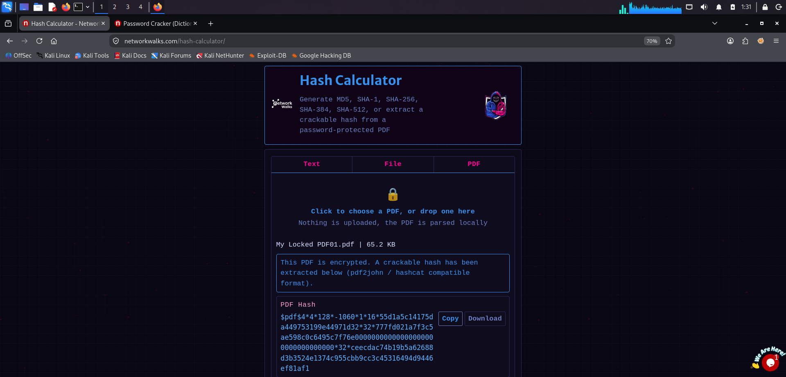
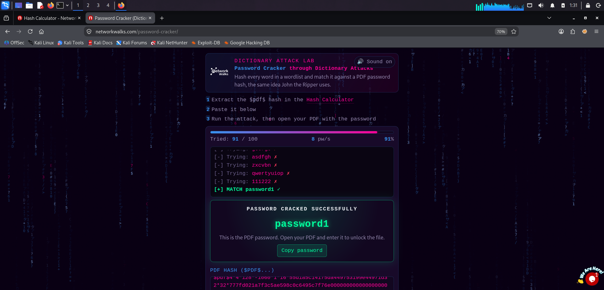
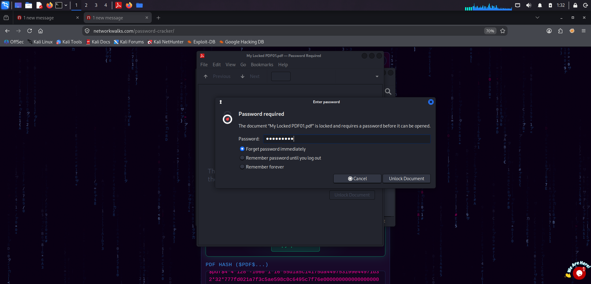
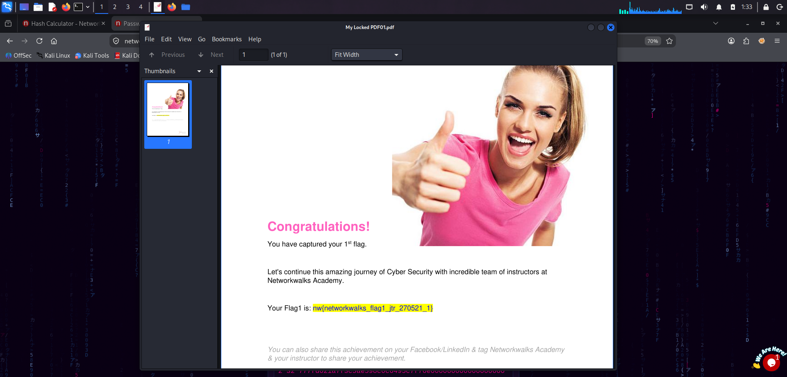
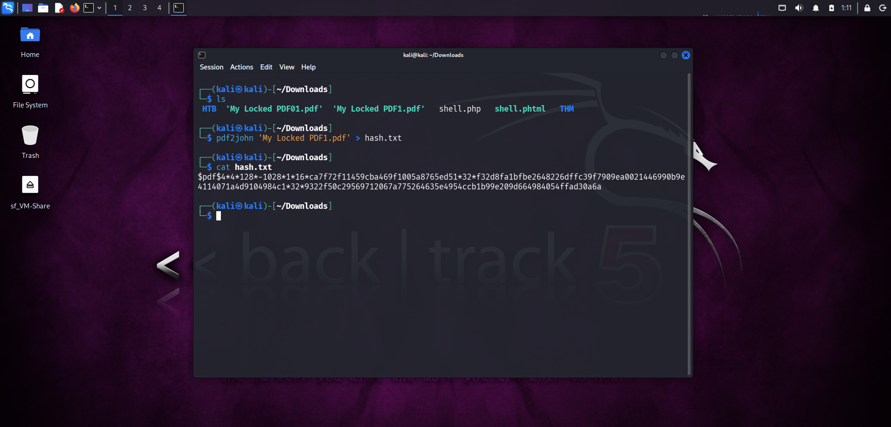
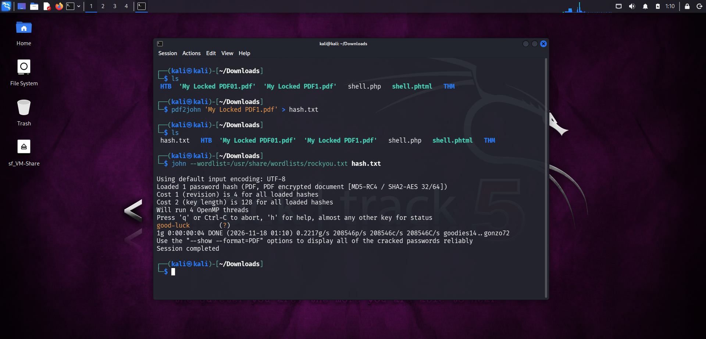
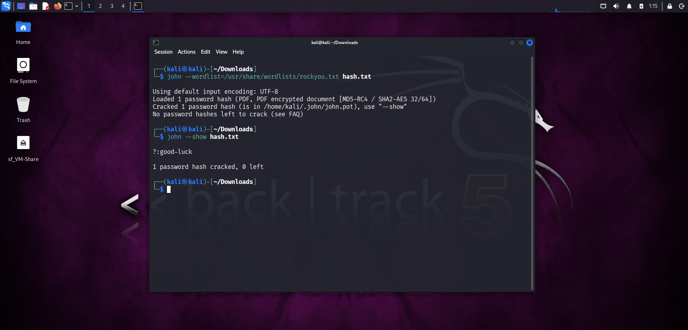
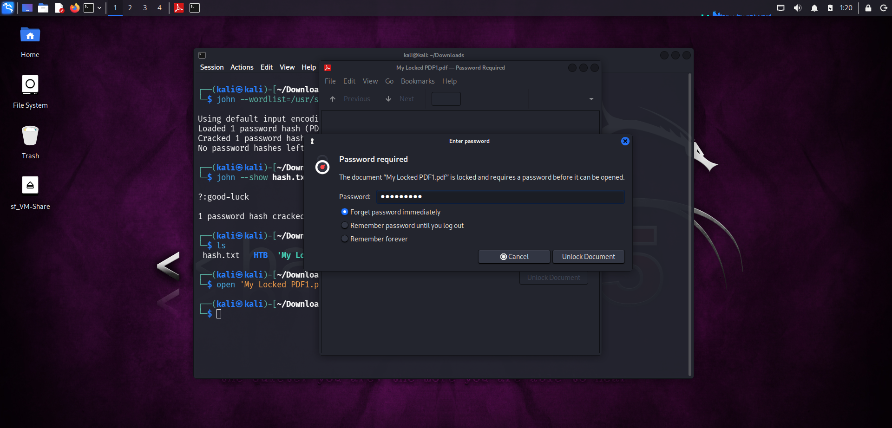

<div align="center">

# 🔓 PASSWORD CRACKING & SECURITY ASSESSMENT
## JOHN THE RIPPER (JTR) & HASH EXTRACTION PRACTICAL
### **WK3-PM1 \| CYBERSECURITY & ETHICAL HACKING \| NETWORKWALKS**

<br>

[](#)
[](#)
[](#)
[](#)
[](#)
[](#)
[](#)
[](#)
[](#)

</div>

---

| **Field** | **Detail** |
| :--- | :--- |
| **Pentester / Analyst Name** | **Dibakor Pramanik** |
| **GitHub Profile** | [@Dibakor007](https://github.com/Dibakor007) |
| **Program & Batch** | **B084 – Networkwalks Cybersecurity Analyst** |
| **Course / Week** | **Week 03 (WK3) – Password Security & Hash Recovery** |
| **Practical Module** | **W3-PM1:** Password Cracking with John the Ripper (JTR) & Hash Extraction |
| **Target Files** | 1. `My Locked PDF01.pdf` (Web-Based Cracking Lab)<br>2. `My Locked PDF1.pdf` (Kali Linux CLI Lab) |
| **Tools & Utilities** | `pdf2john`, `john` (John the Ripper), Networkwalks Hash Calculator, Networkwalks Web Cracker |
| **Wordlists Evaluated** | `rockyou.txt`, `fasttrack.txt`, `JTR_default_password.txt` |
| **Project Status** | **100% Completed (Both Flags Successfully Captured 🚩)** |

---

## Table of Contents
1. [Executive Summary](#1-executive-summary)
2. [Liability Disclaimer & Authorization](#2-liability-disclaimer--authorization)
3. [Repository Structure](#3-repository-structure)
4. [Tools, Wordlists & Environment](#4-tools-wordlists--environment)
5. [Activity 1: Web-Based Password Recovery (Networkwalks Portal)](#5-activity-1-web-based-password-recovery-networkwalks-portal)
   - [5.1 Step 1: Hash Extraction via Web Hash Calculator](#51-step-1-hash-extraction-via-web-hash-calculator)
   - [5.2 Step 2: Dictionary Attack Execution](#52-step-2-dictionary-attack-execution)
   - [5.3 Step 3: Document Decryption & Verification](#53-step-3-document-decryption--verification)
   - [5.4 Step 4: Flag 1 Capture & Analysis](#54-step-4-flag-1-capture--analysis)
6. [Activity 2: Kali Linux CLI Password Cracking (John the Ripper)](#6-activity-2-kali-linux-cli-password-cracking-john-the-ripper)
   - [6.1 Step 1: Extracting Hash with `pdf2john`](#61-step-1-extracting-hash-with-pdf2john)
   - [6.2 Step 2: Wordlist Attack with John the Ripper & `rockyou.txt`](#62-step-2-wordlist-attack-with-john-the-ripper--rockyoutxt)
   - [6.3 Step 3: Verifying Cracked Password (`--show`)](#63-step-3-verifying-cracked-password---show)
   - [6.4 Step 4: Unlocking the Encrypted PDF](#64-step-4-unlocking-the-encrypted-pdf)
   - [6.5 Step 5: Flag 2 Capture & Analysis](#65-step-5-flag-2-capture--analysis)
7. [Comparative Technical Analysis (Web Tools vs. JTR CLI)](#7-comparative-technical-analysis-web-tools-vs-jtr-cli)
8. [Security Risks, Entropy Analysis & Defensive Hardening](#8-security-risks-entropy-analysis--defensive-hardening)
9. [Deliverables & Evidences Summary Table](#9-deliverables--evidences-summary-table)
10. [Conclusion & Sign-off](#10-conclusion--sign-off)

---

## 1. Executive Summary

During **Week 3** of the **Networkwalks Cybersecurity Internship (Batch B084)**, I performed practical hands-on laboratories focused on **Password Security, Hashing Fundamentals, and Offline Password Recovery**.

The objective of this project was to understand how encrypted documents (specifically Adobe PDF files protected by user passwords) protect internal cryptographic keys, how these keys and authentication hashes can be isolated using conversion utilities, and how dictionary/wordlist-based attacks can recover weak passwords.

The project encompassed two distinct operational workflows:
1. **Activity 1 (Web-Based Educational Utilities):** Utilizing Networkwalks' proprietary browser-based Hash Calculator and Dictionary Attack Lab to extract and crack the hash for `My Locked PDF01.pdf`.
2. **Activity 2 (Command-Line Offensive Security Tools):** Utilizing industry-standard Kali Linux utilities—specifically `pdf2john` for hash conversion and **John the Ripper (JTR)** alongside the `rockyou.txt` dictionary—to crack `My Locked PDF1.pdf`.

Both target documents were successfully decrypted, unlocking the educational flags:
- 🚩 **Flag 1:** `nw{networkwalks_flag1_jtr_270521_1}`
- 🚩 **Flag 2:** `nw{cybersecurity_flag_captured_2608}`

---

## 2. Liability Disclaimer & Authorization

> [!WARNING]
> All password recovery, hash extraction, and cryptographic auditing activities documented in this repository were performed strictly on authorized training files (`My Locked PDF01.pdf` and `My Locked PDF1.pdf`) provided as part of the **Networkwalks Academy Cybersecurity Internship Program**. 
> 
> Password cracking tools such as John the Ripper must **never** be used against systems, files, hashes, or communications without explicit written authorization from the data owner. Unauthorized access, hash harvesting, and credential compromise are serious legal violations under cybersecurity regulations worldwide. Every action taken is the sole responsibility of the practitioner.

---

## 3. Repository Structure

The repository is logically organized into dedicated modules containing technical evidence, raw hash outputs, targets, and wordlists:

```text
NETWORKWALKS-DIBAKOR-B084-WK3-Password-Cracking-JTR/
│
├── Activity-1-web-tools/                   # Module 1: Web-based password recovery
│   ├── 1.hash_calculator.png              # Hash extraction via browser utility
│   ├── 2.password_cracked.png             # Successful dictionary attack output
│   ├── 3.using_password.png               # Document unlock prompt verification
│   ├── 4.flag_captured.png                # Flag 1 proof-of-work
│   ├── hash.txt                           # Extracted $pdf$ format hash
│   └── My Locked PDF01.pdf                # Target encrypted document (65.2 KB)
│
├── Activity-2-kali-terminal/               # Module 2: Kali Linux CLI & JTR recovery
│   ├── 1.pdf2john_hash_conversion.png     # Terminal execution of pdf2john
│   ├── 2.password_cracked.png             # JTR cracking session with rockyou.txt
│   ├── 3.show_cracked_password.png        # Verification output using john --show
│   ├── 4.using_password.png               # Entering recovered credentials in Atril
│   ├── 5.flag_captured.png                # Flag 2 proof-of-work
│   ├── hash.txt                           # Extracted $pdf$ hash from CLI
│   └── My Locked PDF1.pdf                 # Target encrypted document (273 KB)
│
├── fasttrack.txt                           # High-priority candidate wordlist
├── JTR_default_password.txt                # Openwall default common passwords list
└── README.md                               # Comprehensive technical project report
```

---

## 4. Tools, Wordlists & Environment

| **Component** | **Type** | **Function / Purpose** |
| :--- | :--- | :--- |
| **Kali Linux** | Operating System | Specialized Debian-based distribution for penetration testing and digital forensics. |
| **John the Ripper (JTR)** | Offline Password Cracker | Fast password cracker by Openwall, capable of auto-detecting and cracking hundreds of hash types. |
| **`pdf2john`** | Conversion Utility | Python script that parses PDF structures and outputs a hash line formatted for JTR/Hashcat. |
| **Networkwalks Hash Calculator** | Web Tool | Client-side JavaScript/WASM utility extracting `$pdf$` hashes locally without cloud uploading. |
| **Networkwalks Password Cracker** | Web Tool | Interactive web interface performing dictionary attacks against extracted hashes. |
| **`rockyou.txt`** | Wordlist | Standard dictionary containing 14+ million real-world passwords leaked from historical breaches. |
| **`JTR_default_password.txt`** | Wordlist | Curated compilation of top unix/web passwords maintained by Solar Designer (Openwall). |
| **`fasttrack.txt`** | Wordlist | FastTrack automated penetration testing wordlist containing common seasonal and administrative credentials. |

---

## 5. Activity 1: Web-Based Password Recovery (Networkwalks Portal)

### 5.1 Step 1: Hash Extraction via Web Hash Calculator
The encrypted target file `My Locked PDF01.pdf` (65.2 KB) was provided to the **Networkwalks Hash Calculator** (`https://networkwalks.com/hash-calculator/`) under the **PDF** tab. The client-side parser inspected the PDF encryption dictionary without uploading file contents, extracting the following JTR-compatible hash:

```text
$pdf$4*4*128*-1060*1*16*55d1a5c14175da449753199e44971d32*32*777fd021a7f3c5ae598c0c6495c7f76e00000000000000000000000000000000*32*ceecdac74b19b5a62688d3b3524e1374c955cbb9cc3c45316494d9446ef81af1
```



---

### 5.2 Step 2: Dictionary Attack Execution
The extracted hash string was entered into the **Networkwalks Dictionary Attack Lab** (`https://networkwalks.com/password-cracker/`). The web engine iterated candidate words through standard PDF encryption transforms:

- **Candidates Tested:** 91 / 100 words evaluated
- **Cracking Rate:** ~8 passwords per second (pw/s)
- **Match Found:** Candidate `#91`
- **Cracked Password:** **`password1`**

```text
[-] Trying: asdfgh ✗
[-] Trying: zxcvbn ✗
[-] Trying: qwertyuiop ✗
[-] Trying: 111222 ✗
[+] MATCH password1 ✓
=========================================
PASSWORD CRACKED SUCCESSFULLY: password1
=========================================
```



---

### 5.3 Step 3: Document Decryption & Verification
With the recovered password (`password1`), I attempted to open `My Locked PDF01.pdf` using Kali Linux’s native document viewer (**Atril**). The application prompted for credentials; entering `password1` successfully unlocked the container.



---

### 5.4 Step 4: Flag 1 Capture & Analysis
Upon opening the unlocked PDF, the first challenge flag was revealed:

> **Captured Flag 1:**  
> `nw{networkwalks_flag1_jtr_270521_1}`



---

## 6. Activity 2: Kali Linux CLI Password Cracking (John the Ripper)

### 6.1 Step 1: Extracting Hash with `pdf2john`
For the advanced practical, the target was `My Locked PDF1.pdf` (273 KB). In a Kali Linux terminal, I navigated to the working directory and used `pdf2john` to convert the PDF encryption headers into a crackable hash file:

```bash
cd ~/Downloads
pdf2john 'My Locked PDF1.pdf' > hash.txt
cat hash.txt
```

**Extracted Hash:**
```text
$pdf$4*4*128*-1028*1*16*ca7f72f11459cba469f1005a8765ed51*32*f32d8fa1bfbe2648226dffc39f7909ea0021446990b9e4114071a4d9104984c1*32*9322f50c29569712067a775264635e4954ccb1b99e209d664984054ffad30a6a
```

*Hash Breakdown:*
- `$pdf$`: JTR identifier for PDF hash format.
- `4*4*128`: Represents PDF version, encryption revision (Revision 4), and key length (128-bit key).
- Cryptographic algorithm: Combined MD5-RC4 / SHA2-AES encryption scheme.



---

### 6.2 Step 2: Wordlist Attack with John the Ripper & `rockyou.txt`
Next, I launched John the Ripper against `hash.txt` utilizing the industry-standard wordlist `/usr/share/wordlists/rockyou.txt`:

```bash
john --wordlist=/usr/share/wordlists/rockyou.txt hash.txt
```

**Terminal Session Output:**
```text
Using default input encoding: UTF-8
Loaded 1 password hash (PDF, PDF encrypted document [MD5-RC4 / SHA2-AES 32/64])
Cost 1 (revision) is 4 for all loaded hashes
Cost 2 (key length) is 128 for all loaded hashes
Will run 4 OpenMP threads
Press 'q' or Ctrl-C to abort, 'h' for help, almost any other key for status
good-luck        (?)
1g 0:00:00:04 DONE (2026-11-18 01:10) 0.2217g/s 208546p/s 208546c/s 208546C/s goodies14..gonzo72
Use the "--show --format=PDF" options to display all of the cracked passwords reliably
Session completed
```

- **Execution Metrics:**
  - Multi-threading: **4 OpenMP threads** leveraged.
  - Cracking Speed: **208,546 candidate combinations per second** (`208546 c/s`).
  - Total Duration: **4 seconds**.
  - **Recovered Password:** **`good-luck`**



---

### 6.3 Step 3: Verifying Cracked Password (`--show`)
To confirm that John the Ripper logged the cracked hash to its internal potfile (`~/.john/john.pot`), I executed:

```bash
john --show hash.txt
```

**Verification Output:**
```text
?:good-luck

1 password hash cracked, 0 left
```



---

### 6.4 Step 4: Unlocking the Encrypted PDF
Using the recovered plaintext credential (`good-luck`), I unlocked `My Locked PDF1.pdf` within the document reader:

```bash
xdg-open 'My Locked PDF1.pdf'
```



---

### 6.5 Step 5: Flag 2 Capture & Analysis
The secured PDF opened and displayed the official Week 3 completion flag:

> **Captured Flag 2:**  
> `nw{cybersecurity_flag_captured_2608}`


---

## 7. Comparative Technical Analysis (Web Tools vs. JTR CLI)

| **Evaluation Metric** | **Web-Based Portal (Activity 1)** | **John the Ripper CLI (Activity 2)** |
| :--- | :--- | :--- |
| **Processing Power** | Constrained by browser JavaScript sandbox / single thread | Native CPU compilation utilizing all available CPU cores (OpenMP) |
| **Throughput Speed** | ~8 passwords/second | **208,546 passwords/second** (Over 26,000x faster) |
| **Dictionary Capacity** | Small embedded wordlists (~100–1,000 words) | Massive wordlists (e.g., `rockyou.txt` with 14.3M words) |
| **Rule-Based Mutation** | Not supported | Highly extensible mangling rules (`--rules`) |
| **Operational Privacy** | Relies on client-side JS implementation | 100% offline, air-gapped security suitable for sensitive engagements |
| **Ideal Use Case** | Quick demonstrations, basic awareness training | Professional penetration testing, forensic investigations, credential auditing |

---

## 8. Security Risks, Entropy Analysis & Defensive Hardening

### 8.1 Why Did These Passwords Fail?
1. **Low Shannon Entropy:**  
   - `password1` uses a standard dictionary term with predictable trailing digits. It appears on almost every global "Top 10 Most Common Passwords" list.
   - `good-luck` uses two common English dictionary words joined by a hyphen, without numbers, symbols, or case variation.
2. **Predictable Human Behavior:**  
   Users consistently choose mnemonic phrases or slight variations of common words to bypass basic length requirements.
3. **Lack of Computational Work Factor in Legacy Formats:**  
   Standard 128-bit PDF encryption (Revision 4) allows fast hash checking at hundreds of thousands of hashes per second on modest CPU hardware, and millions per second on GPU rigs (Hashcat).

### 8.2 Enterprise Hardening Recommendations
- **Adopt Modern Encryption Standards:** Protect sensitive PDF and archive documents using **AES-256 (Revision 6 / ISO 32000-2)** encryption, which incorporates hardened key derivation functions.
- **Enforce Complex Passphrases:** Mandate passwords with a minimum length of 16 characters or 4+ randomly generated words (e.g., Diceware passphrases).
- **Implement Multi-Factor Authentication (MFA):** Document and portal access should be gated behind modern identity providers with hardware token or TOTP MFA.
- **Implement Rate-Limiting & Account Lockouts:** Enforce exponential backoff delays on authentication endpoints to render automated dictionary attacks infeasible.

---

## 9. Deliverables & Evidences Summary Table

| **Item** | **Activity** | **Target File** | **Method / Command** | **Recovered Value** |
| :---: | :---: | :--- | :--- | :--- |
| **01** | Activity 1 | `My Locked PDF01.pdf` | Web Hash Calculator | `$pdf$4*4*128*-1060*...` |
| **02** | Activity 1 | `hash.txt` | Web Password Cracker | Password: **`password1`** |
| **03** | Activity 1 | `My Locked PDF01.pdf` | Document Unlock | Authenticated successfully |
| **04** | Activity 1 | Document View | Flag 1 Proof | 🚩 **`nw{networkwalks_flag1_jtr_270521_1}`** |
| **05** | Activity 2 | `My Locked PDF1.pdf` | `pdf2john 'My Locked PDF1.pdf'` | `$pdf$4*4*128*-1028*...` |
| **06** | Activity 2 | `hash.txt` | `john --wordlist=rockyou.txt` | Password: **`good-luck`** |
| **07** | Activity 2 | Potfile Check | `john --show hash.txt` | Verified `?:good-luck` |
| **08** | Activity 2 | `My Locked PDF1.pdf` | Document Unlock | Authenticated successfully |
| **09** | Activity 2 | Document View | Flag 2 Proof | 🚩 **`nw{cybersecurity_flag_captured_2608}`** |

---

## 10. Conclusion & Sign-off

The Week 3 practical lab on **Password Cracking and Hash Extraction** provided crucial offensive and defensive perspectives on credential security. Through practical experimentation with both web utilities and John the Ripper in Kali Linux, I learned the complete lifecycle of offline credential recovery:
- Extracting raw cryptographic hashes from target binary files.
- Selecting appropriate wordlists based on the scenario.
- Leveraging high-performance multi-threaded cracking tools to identify passwords in seconds.
- Validating the findings by accessing the secured assets and retrieving the objective flags.

This lab proves that encryption is only as secure as the underlying password entropy. As security analysts, enforcing robust key lengths, modern KDFs, and strict passphrase policies is paramount to defending systems against offline dictionary attacks.

<br>

<div align="center">

**— End of Week 3 Laboratory Report —**

<br>

👤 **Author:** **Dibakor Pramanik**  
Cybersecurity Analyst \| Batch B084  
GitHub Profile: [https://github.com/Dibakor007](https://github.com/Dibakor007)

📌 **Project Information:**  
Program: **Networkwalks Cybersecurity & Ethical Hacking Internship**  
Module: **Week 03 – Password Cracking with John the Ripper (W3-PM1 and W3-PM2)**  
Repository Reference: [`NETWORKWALKS-DIBAKOR-B084-WK3-Password-Cracking-JTR`](https://github.com/Dibakor007/NETWORKWALKS-DIBAKOR-B084-WK3-Password-Cracking-JTR)

</div>

